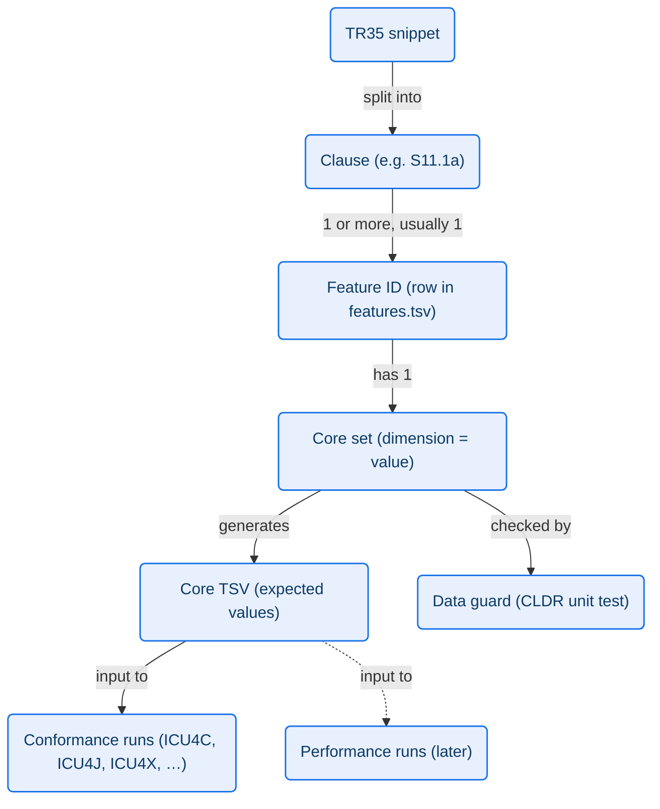

# Feature-Based Test Generation for CLDR Conformance Tests

|   |   |
|---|---|
| Author | Younies Mahmoud |
| Date | 2026-10-09 |
| Status | Proposal |
| Bugs | [CLDR-19466](https://unicode-org.atlassian.net/browse/CLDR-19466) |

## 1. Problem

We need the test data organized by feature, so that we can make sure the spec is covered and that the data for each part of the spec tests what it should.

Today the test data (`common/testData/decimal/`, and `common/testData/currency/` in [#5808](https://github.com/unicode-org/cldr/pull/5808)) is a cross product of dimensions, e.g. locales × currencies × styles × inputs. The decimal files alone have 8,925 rows. They catch regressions, but:

- A failing row doesn't say which part of TR35 it tests.
- Nothing proves that every part of TR35 is tested.
- If CLDR data changes (e.g. PTE loses its own decimal separator in `pt_PT`), a row still passes but no longer tests that part of the spec.

Related work: the TR35 test coverage docs (CLDR-19466) split the currency and decimal sections of TR35 into numbered clauses (e.g. S11.1a), and [unicode-org/conformance](https://github.com/unicode-org/conformance) runs test data against ICU4C, ICU4J, ICU4X, NodeJS and other implementations.

## 2. Goals

1. A failure names the TR35 clause that the implementation (or the spec) gets wrong.
2. Every TR35 clause in scope has at least one feature, and every feature has tests (100% coverage).
3. If CLDR data no longer has the case a test relies on, a CLDR unit test fails.
4. Later, the same test cases measure performance per feature.

## 3. Terms

| Term | Meaning | Example |
|---|---|---|
| **Category** | One formatter area with its own dimensions. | `currency`, `decimal`, unit formatting |
| **Dimension** | One input of the formatter. | `locale`, `currency`, `currency_display`, `input` |
| **Clause** | One part of a TR35 snippet, as split in the coverage doc (4.5). | S11.1a: currency-specific `decimal` |
| **Feature** | A behavior that a clause requires, with a stable ID (4.1). | `currency_decimal_separator_special_currency` |
| **Core set** | The `(dimension = value)` pairs that exercise one feature. | `locale = pt_PT`, `currency = PTE` |
| **Core TSV** | The test cases generated from one core set (4.3). | `core_currency_decimal_separator_special_currency.tsv` |
| **Data guard** | A CLDR unit test that checks that the core set still exercises the feature (4.4). | `pt_PT` PTE `decimal` exists and ≠ `pt_PT` `decimal` |

## 4. Design

### 4.1 Feature IDs

- Format: `<category>_<area>_<detail>`, lowercase snake case, e.g. `currency_decimal_separator_special_currency`, `currency_no_currency_pattern`.
- An ID never changes and is never reused. If the data for a feature disappears, the core set changes, not the ID.
- One feature per clause by default, and one feature can serve several clauses.

A sub-case of a clause (another display, length or format type) gets its own feature only if it has:

- its own spec text,
- its own data requirement (a different data guard), or
- an unclear or disputed spec reading.

Example: S11.1a (currency-specific `decimal`) is `currency_decimal_separator_special_currency`. Its compact case (`1$3 mil`) is still being discussed in [CLDR-19798](https://unicode-org.atlassian.net/browse/CLDR-19798), so it is a separate feature, `currency_decimal_separator_special_currency_compact`, and a compact failure doesn't mark the clear part of the clause as failing.

### 4.2 Feature registry

`common/testData/<category>/features.tsv` is the single source of truth for the features of a category. It is TSV like the test data, so GitHub shows it as a table and the CLDR tools need no new library.

| Column | Example |
|---|---|
| `feature_id` | `currency_decimal_separator_special_currency` |
| `spec` | `tr35-numbers.md#currency-specific-decimal-and-grouping-overrides` |
| `clause` | `S11.1a` |
| `core_set` | `locale=pt_PT; currency=PTE; currency_display=symbol; input=1234565.0,-1230.05` |
| `summary` | A currency's own `decimal` replaces the locale's `decimal`. |

- `clause` lists every clause the feature serves, comma-separated.
- `core_set` has `dimension=value` pairs separated by `; `, and several values of one dimension separated by `,`.
- Like the core TSVs, every line has the same number of tabs, and no cell contains `"` (4.3).

A generator per category (`GenerateCurrencyFeatureTestData`, later `GenerateDecimalFeatureTestData`), separate from the existing cross-product generators, reads the registry and writes one core TSV per feature, with every combination of the core set's values. Where a feature needs its own generator code (usually a new dimension), that code has a comment with the feature ID and clause, for readers only.

### 4.3 Core TSV files

- Path: `common/testData/<category>/core_<feature_id>.tsv`, in the same folder and README as the cross-product files.
- Columns: every dimension of the category (empty = default), then `expected`, `main_feature` and `other_features`. All core TSVs of a category share this header, so one parser reads them all.
- The generator only has the dimensions that some feature needs. Adding a dimension adds its column, before `expected`, to every core TSV of the category, so readers should find columns by their header name.
- `main_feature` is the feature the core set was made for: the same in every row, and it matches the file name. `other_features` lists other features the row may affect (comma-separated, may be empty). The generator fills it from the formatted value and CLDR data, so nobody edits it by hand.
- Every line, including the `#` header, has the same number of tabs, so GitHub shows the file as a table (requested in the review of [#5808](https://github.com/unicode-org/cldr/pull/5808)). That is why metadata stays in the registry, not in extra `#` lines.
- No cell contains `"`. GitHub reads it as a quote and shows an error instead of the table.

Example, `core_currency_decimal_separator_special_currency.tsv` (`pt_PT` group is U+00A0 and minimum grouping digits is 2; PTE has `decimal` `$`, `group` `,` and symbol U+200B):

| locale | currency | … | currency_display | input | expected | main_feature | other_features |
|---|---|---|---|---|---|---|---|
| pt_PT | PTE | … | symbol | 1234565.0 | `1,234,565$00 ​` (`1,234,565$00\u00A0\u200B`) | `currency_decimal_separator_special_currency` | `currency_group_separator_special_currency` |
| pt_PT | PTE | … | symbol | -1230.05 | `-1230$05 ​` (`-1230$05\u00A0\u200B`) | `currency_decimal_separator_special_currency` | |

### 4.4 Data guards

A new test class per category, `TestCurrencyFeatureData` (later `TestDecimalFeatureData`), has one guard per feature, in a map keyed by feature ID. A guard gets the feature's registry row and checks the CLDR facts that make each locale (and currency) in its core set exercise the feature. It checks nothing about formatted output. For example, the guard of `currency_decimal_separator_special_currency` checks that PTE has its own `decimal` in `pt_PT`, and that it differs from the `pt_PT` `decimal`. A small shared class (`FeatureRegistry`) reads `features.tsv` for every category.

The guards are kept apart from the tests that compare the TSVs with the generator's output, so a guard failure says that CLDR data changed. The fix is to find a new core set, update it in the registry, and regenerate the core TSV. The guard changes only if the reason the core set works changes, and the feature ID stays the same.

If a CLDR data PR breaks a guard, that PR can mark the guard as a known issue (`logKnownIssue` with a ticket), and a follow-up PR finds the new core set.

### 4.5 Coverage check

The same class also checks that:

1. Every `in_scope` clause in `clauses.tsv` has a feature in the registry, and every clause in the registry is in `clauses.tsv`.
2. Every feature has a core TSV with at least one row and a data guard, and every data guard belongs to a feature.
3. Every `main_feature` matches its file name, and every ID in `main_feature` and `other_features` is in the registry.

`common/testData/<category>/clauses.tsv` lists the clauses of the category's coverage doc, one per row, with the columns `clause`, `spec`, `status` and `note`:

- `status` is `in_scope`, `waiting` (4.8) or `out_of_scope`.
- `note` gives the ticket or the reason for `waiting` and `out_of_scope`.

Check 1 reads this file rather than the coverage doc, so it works before that doc is on `main`.

Goal 2 (100% coverage) is met when this check passes and no clause is `waiting`. Whether an implementation passes each feature is a separate question, answered by the conformance report (4.6).

### 4.6 Conformance repo

In [unicode-org/conformance](https://github.com/unicode-org/conformance):

- `testgen` gets a currency test type (it has none today). It reads `core_*.tsv` and writes its JSON test and verify files, keeping `main_feature` and `other_features` on each test case.
- `verifier` groups results by main feature, then by clause. A report row reads: *`currency_decimal_separator_special_currency` (S11.1a): ICU4C ✅, ICU4X ❌ 1/2*.
- A feature that fails in every implementation points to the spec or the expected value. A feature that fails in one implementation points to that implementation.

### 4.7 Performance (later)

The core TSVs are also the benchmark inputs. Each implementation reports the time per operation for each feature, so a slow feature (e.g. compact + `alphaNextToNumber`) shows up by name.

### 4.8 Expected values

For now, ICU4J produces the expected values, as the current generators do. If ICU4J is wrong, the core TSV is wrong too, so until there is a second source, a conformance run can't catch an ICU4J bug, or a spec error that ICU4J shares. Two cases are known ahead of time:

- **ICU4J differs from the spec:** the feature waits. It gets no core TSV, and its clauses are `waiting` in `clauses.tsv`, with the ICU ticket. For example, ICU4J applies `currencySpacing` instead of the `alt="alphaNextToNumber"` step of compact formatting, so the cases where the two give different results wait.
- **The spec is unclear:** the feature follows the literal reading and links the spec ticket in its summary, so a failure there points to the spec first (4.1).

Later, a naive but correct reference implementation of the spec (written for clarity, not speed) replaces ICU4J, one feature at a time, starting with the waiting features. Rows where the two differ are ICU4J bugs or spec ambiguities, reported against the row's feature and clause.

## 5. Adding a feature

1. Pick a clause in `clauses.tsv` that has no feature yet, and assign a feature ID.
2. Find a core set in CLDR data. If the core set needs a new dimension, add it to the generator.
3. Write the data guard.
4. Add the registry row and regenerate the core TSVs.

## 6. Rollout

1. Currency, as a stack of small PRs ([#6258](https://github.com/unicode-org/cldr/pull/6258), [#6259](https://github.com/unicode-org/cldr/pull/6259) and [#6261](https://github.com/unicode-org/cldr/pull/6261) so far):
   - The first PR, based on `main`, adds the registry, the generator, the data guards and coverage checks 2 and 3, with the first features of section 1 and only the dimensions they need.
   - Each later PR adds the features of one TR35 heading, or of part of a coverage section, and the dimensions they need.
   - A later PR adds `clauses.tsv` and check 1 (4.5).
2. Conformance repo: the currency test type in `testgen`, and `verifier` support for `main_feature` and `other_features`.
3. Decimal: sections 1–15, in the same way.
4. Performance runs.
5. Reference implementation: replace ICU4J as the source of expected values, one feature at a time, starting with the waiting features (4.8).

## 7. Alternatives considered

- Tag the rows of the existing cross-product files with feature IDs. This needs no new files, but the cross product lacks many combinations that features need (no row in [#5808](https://github.com/unicode-org/cldr/pull/5808) uses `fr_CH` or `de_AT`, for example), and the files are too large to review by feature.
- One core file per category instead of one per feature. This means far fewer files (currency alone will likely have dozens of features), but every feature PR would edit the same file, and a failure couldn't point to one file with that feature's cases. Every row already has `main_feature`, so the files can still be merged later without losing anything.
